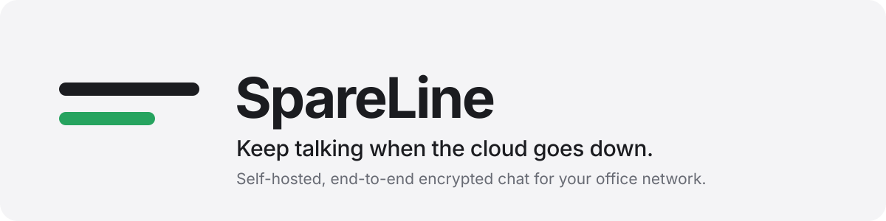
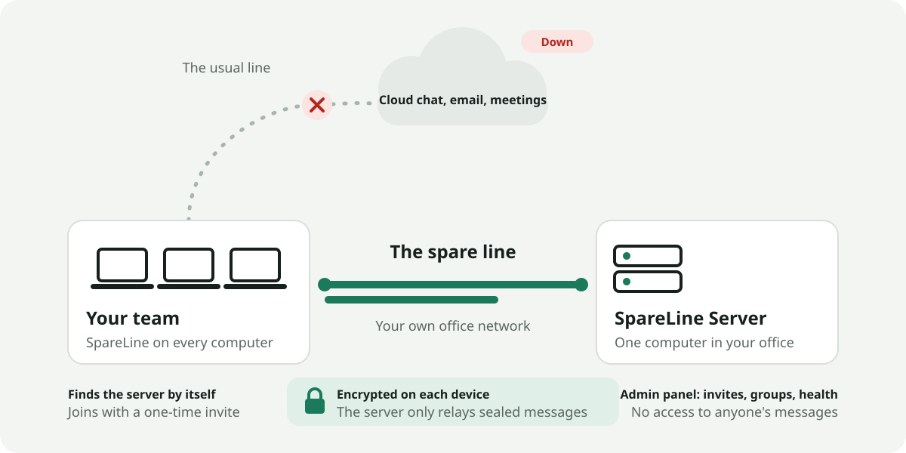

  

**SpareLine is a backup chat app for your organisation.** When your usual cloud chat, email or meeting tools go down, everyone can keep talking over your own office network. It doesn't need the internet or any outside company.

  

## How it works

1. **Switch on the server.** Install SpareLine Server on one computer in your office. It sets itself up.
2. **Hand out invites.** Each person gets a one-time code. Do this before you need it.
3. **Staff join.** The SpareLine app finds the server on the network by itself and checks it's the real one.
4. **When the cloud goes down, keep talking.** Messages are encrypted on each person's computer. The server only passes sealed messages along.

## See it

<table>
  <tr>
    <td width="50%"></td>
    <td width="50%"></td>
  </tr>
  <tr>
    <td align="center">The chat app</td>
    <td align="center">The server control panel</td>
  </tr>
</table>

## Security and privacy

SpareLine runs entirely on computers your organisation owns. It doesn't send anything to the internet or to an outside company, and nobody but the people in a chat can read it, including the admin.

| Only the people in the chat can read | The server knows, so it can deliver messages |
|---|---|
| Messages, replies, edits and reactions | Accounts, groups and who is in each chat |
| Chat names | When a message was sent and its size |
| Each person's chat history | Who is online, typing, or has read a chat |

**How it's protected**

- **End-to-end encryption.** Messages are locked on the sender's computer with [MLS](https://www.rfc-editor.org/rfc/rfc9420), the open standard for secure group messaging. The server only stores and passes on sealed messages.
- **No back door for admins.** The control panel works only on the server computer, can't be reached over the network, and has no screen that shows conversations. It locks after 15 minutes without use.
- **The app checks it's talking to the real server.** The invite code proves the server's identity on first connect. After that, the app trusts only that server's certificate, so a fake server on the network is refused.
- **Safe sign-in.** Passwords are stored as Argon2id hashes, repeated sign-in attempts are limited, and each computer keeps its sign-in in Windows Credential Manager or the macOS Keychain.
- **Groups stay separate.** People can only find and message others who share a group with them. The server enforces this.
- **History is encrypted on each computer too**, with its key held in the same secure store.

**Worth knowing**

- An admin can give an account a new device with a setup code, for example after a forgotten password. That device gets new messages only, never past ones, and everyone in the chat sees "… joined from a new device".
- Admin announcements aren't encrypted, so they shouldn't contain anything confidential.

The [privacy statement](docs/PRIVACY.md) has the full list of what is stored and for how long. Found a security problem? Please report it privately: open the **Security** tab and choose **Report a vulnerability**.

## Good to know

- **Calm to use.** Light and dark themes, larger text, high contrast and full keyboard support.
- **Easy to look after.** The control panel shows who's connected, what's wrong and how to fix it.

## Get started

| You are… | Start here |
|---|---|
| Setting it up for your organisation | [Admin guide](docs/ADMIN_GUIDE.md) |
| Using it at work | [Quick start](docs/USER_QUICKSTART.md) |
| Building or improving it | [Contributing](CONTRIBUTING.md) |

## Cite it

Writing about SpareLine? Use **Cite this repository** in the sidebar on GitHub to copy an APA or BibTeX citation, or take the details from [CITATION.cff](CITATION.cff).

---

SpareLine is written in Rust and is in early development (v0.1). Licensed under either [MIT](LICENSE-MIT) or [Apache 2.0](LICENSE-APACHE), at your option.
