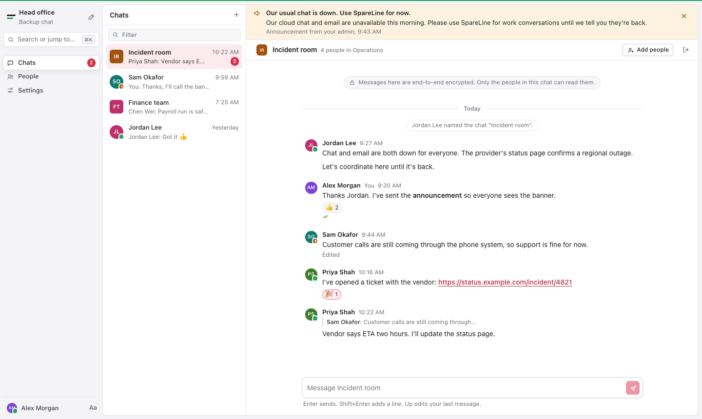
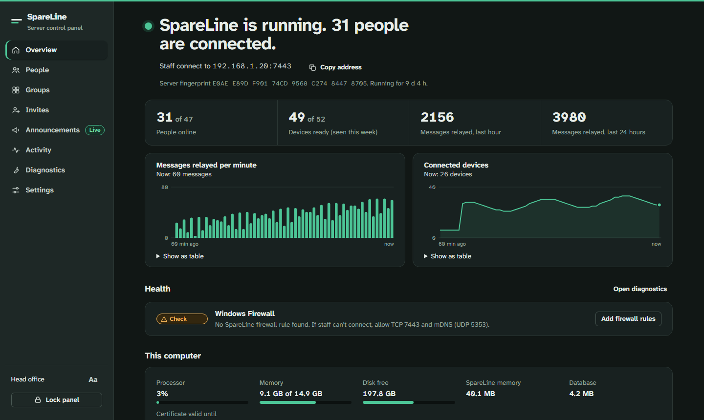

**SpareLine is a backup chat app for your organisation.** When your usual cloud chat, email or meeting tools go down, everyone can keep talking over your own office network. It doesn't need the internet or any outside company.

  

## How it works

1. **Switch on the server.** Install SpareLine Server on one computer in your office. It sets itself up.
2. **Hand out invites.** Each person gets a one-time code. Do this before you need it.
3. **Staff join.** The SpareLine app finds the server on the network by itself and checks it's the real one.
4. **When the cloud goes down, keep talking.** Messages are encrypted on each person's computer. The server only passes sealed messages along.

  

A 1:43 screen recording with captions and no sound. It sets up the server, hands out invites, joins as a member of staff, and keeps talking when the cloud is down. To pause or skip through it, open the <a href="docs/assets/walkthrough.mp4">video file</a>.

<table>
  <tr>
    <td width="50%"></td>
    <td width="50%"></td>
  </tr>
  <tr>
    <td align="center">The chat app</td>
    <td align="center">The server control panel</td>
  </tr>
</table>

## Security and privacy

SpareLine runs entirely on computers your organisation owns. It doesn't send anything to the internet or to an outside company, and only the people in a chat can read it: not the server, and not the admin.

### What stays private

| | People in the chat | SpareLine Server | Admin, in the control panel |
|---|:---:|:---:|:---:|
| **Messages, replies and edits** | ✓ | Sealed | — |
| **Reactions and deletions** | ✓ | Sealed | — |
| **Chat names** | ✓ | Sealed | — |
| **Who is in each chat** | ✓ | ✓ | — |
| **When each message was sent, and its size** | ✓ | ✓ | Totals per minute only |
| **Typing, and how far people have read** | ✓ | ✓ | — |
| **Who is online** | People who share a group | ✓ | ✓ |
| **Accounts, groups and devices** | Names of people who share a group | ✓ | ✓ |

**Sealed** means the server holds the encrypted message but has no key to open it. Typing isn't stored, and anyone can turn off read receipts in Settings. Each person's chat history stays on their own computer, encrypted.

### How it's protected

| | |
|---|---|
| **Messages** | End-to-end encrypted on the sender's computer with [MLS](https://www.rfc-editor.org/rfc/rfc9420), the open standard for secure group messaging. Each device has its own keys, and a chat's keys change whenever someone joins or leaves. The server only stores and passes on sealed messages. |
| **The connection** | TLS 1.2 or 1.3 on port 7443. The server makes its own certificate, and the app trusts only that certificate, so a fake server on the network is refused. |
| **Joining** | The app checks the server is real before it sends anything. The server must answer a challenge using a secret from the invite, tied to its certificate. Invite codes work once, expire, and are shown only once. |
| **Sign-in** | Passwords are stored as Argon2id hashes. Each device gets its own sign-in token, which the server keeps only as a hash and which ends after 30 days without use. Repeated attempts are limited per username and network address. |
| **On each computer** | Message text and chat names are encrypted with a key kept in Windows Credential Manager or the macOS Keychain, along with the sign-in token. |
| **Who can talk to whom** | People can only find and message others who share a group with them. The server checks this every time someone is added to a chat. |
| **The control panel** | Runs only on the server computer and can't be reached over the network. It has no screen, export or tool that shows conversations. It needs the admin password, locks after 15 minutes without use, and records every admin action in an audit log. |
| **Removing access** | Removing a device or disabling an account signs it out at once and takes it out of every chat, so it can't read anything sent afterwards. |
| **No outside services** | No analytics, crash reporting, update checks or cloud accounts. The app finds the server on the local network with mDNS (UDP 5353), and staff can type the address if the network blocks that. |

### What the server keeps

| Data | Kept for |
|---|---|
| Sealed messages waiting for offline devices | 30 days by default, adjustable in Settings |
| Connection history, for troubleshooting | 7 days |
| Problem reports sent by staff apps | 30 days |
| Server logs, which never contain message content | 14 days |
| Backups of the server database | The last 7 daily backups |
| Standby copies, if turned on | The last 4, encrypted with a standby password, in a folder you choose |
| Accounts and groups | Until an admin deletes them |
| The audit log of admin actions | Not deleted automatically |

### Limits to know about

- **Setup codes add a device.** An admin can give someone a setup code, for example after a forgotten password. The new device gets new messages only, never past ones, and everyone in the chat sees "… joined from a new device", so it can't happen silently.
- **Announcements aren't encrypted.** Keep confidential information out of them.
- **The server sees who, when and how much.** It knows who is in each chat and when messages are sent, but never what they say.
- **History is only as safe as the computer.** Anyone who can sign in to a person's computer account can open SpareLine as them. Use screen locks and full-disk encryption (BitLocker or FileVault). Encrypting the whole local database is planned.
- **Protect the server and its backups.** They hold account details, password hashes and sealed messages, though nothing readable. Standby copies hold the same, plus the server's certificate key, and open only with the standby password.

The [privacy statement](docs/PRIVACY.md) lists everything that is stored, and the [protocol notes](docs/PROTOCOL.md) describe the trust model and cryptography in full. Found a security problem? Please report it privately: open the **Security** tab and choose **Report a vulnerability**.

## Get started

| You are… | Start here |
|---|---|
| Setting it up for your organisation | [Admin guide](docs/ADMIN_GUIDE.md) |
| Running the server from the command line | [Command-line options](docs/ADMIN_GUIDE.md#running-without-the-control-panel) |
| Using it at work | [Quick start](docs/USER_QUICKSTART.md) |
| Building or improving it | [Contributing](CONTRIBUTING.md) |

## Cite it

Writing about SpareLine? Use **Cite this repository** in the sidebar on GitHub to copy an APA or BibTeX citation, or take the details from [CITATION.cff](CITATION.cff).

---

SpareLine is written in Rust and is in early development (v0.1). Licensed under either [MIT](LICENSE-MIT) or [Apache 2.0](LICENSE-APACHE), at your option.
